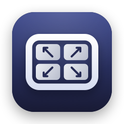

<p align="center">
  
</p>

<h1 align="center">DisplayArranger</h1>

<p align="center">
  A small menu bar app for rearranging your displays without opening System Settings.
</p>

## Features

- **Drag to arrange**: move displays around in a live preview. They snap to the edges of other displays and line up with their centres and edges.
- **Quick-snap buttons**: hover a display and click ↑ ↓ ← → to place it centred on that side of the main display.
- **Real wallpapers**: each display in the preview shows its own desktop picture.
- **Preview before applying**: a dashed outline shows where a drag will land, and the old position stays outlined until you click **Apply** or **Reset**.
- **Up to four displays**: the main display plus three more, including Sidecar.
- **Stays out of the way**: lives in the menu bar with no Dock icon, and only appears while more than one display is connected.
- **Run at startup**: optional, off by default.

DisplayArranger was made with **Sidecar** in mind: if you often connect an iPad, it's a quick way to put it back where you want it.

## Install

1. Download the latest `DisplayArranger-x.y.z.dmg` from [Releases](https://github.com/olesollid/DisplayArranger/releases/latest).
2. Open it and drag **DisplayArranger** onto **Applications**.
3. Open the app. macOS will block it the first time, because the app is not notarized. Go to **System Settings → Privacy & Security** and click **Open Anyway**.

<details>
<summary>Verify the download (optional)</summary>

Each release includes a SHA-256 checksum and a build attestation, which proves the DMG was built by this repository's GitHub Actions workflow.

```bash
shasum -a 256 DisplayArranger-x.y.z.dmg   # compare with the .sha256 file
gh attestation verify DisplayArranger-x.y.z.dmg --repo olesollid/DisplayArranger
```

</details>

## Requirements

- macOS 13 Ventura or later
- At least two displays

## Limitations

- The main display (the one with the menu bar) stays in place; the others are arranged around it. To change which display is the main one, use System Settings.
- Only the first three additional displays are shown; any more are left as they are. Mirrored displays are ignored.
- Dynamic and aerial wallpapers, and any picture the app can't read, show a placeholder image instead.

## Building from source

Open `DisplayArranger.xcodeproj` in Xcode and run the **DisplayArranger** scheme, or build from the command line without a signing certificate:

```bash
xcodebuild -project DisplayArranger.xcodeproj -scheme DisplayArranger -configuration Release \
  CODE_SIGN_IDENTITY=- CODE_SIGN_STYLE=Manual DEVELOPMENT_TEAM= build
```

Releases are automated: commits to `main` follow [Conventional Commits](https://www.conventionalcommits.org), and [release-please](https://github.com/googleapis/release-please) turns them into versioned releases with a changelog and a DMG.

## License

[GPL-2.0](LICENSE)
